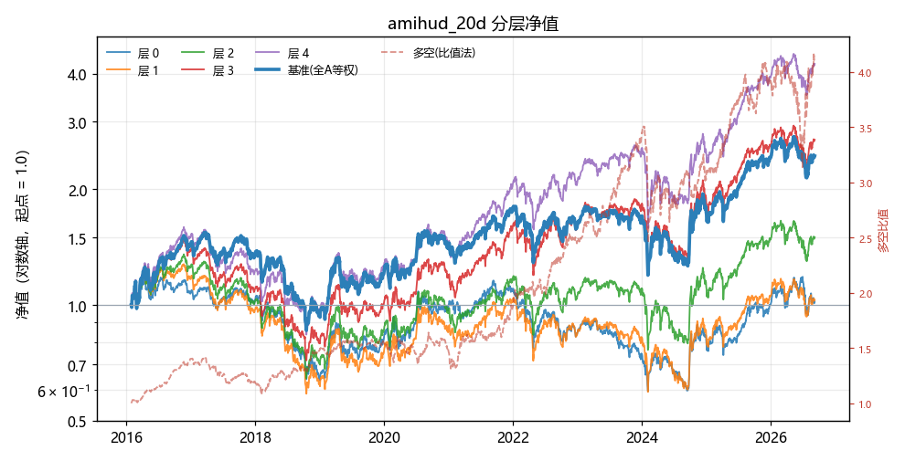

# Mini-Alpha

> 这是什么：**一个学生搭建的「能自己加因子、结论可复现」的轻量级 A 股单因子研究平台。**
> *A reproducible single-factor research platform for China A-shares — add a factor in one line.*

---

## 0. 这是什么 / 不是什么（30 秒读完）

| 是  | 不是 |
| :-- | :-- |
| 一个可以跑通：**清洗 → 宽表 → 指标 → 因子 → 分层回测 → 报告** 的研究流程的项目| 实盘交易系统 （没有下单/执行算法/风控） |
| **加一个因子 = 加一条字典**（多数情况） | 多因子组合/中性化平台 （市值、行业还没进来） |
| 每条结论都**可复现**（同输入逐位相同、有台账、有断言） | 行情终端 / 数据销售  |

**能力边界（说清楚）**：
- 现在能**严谨**回答：**「这个因子有没有区分度」** （分层单调性、IC/ICIR、换手、多空、成本后净值）
- 现在还**不能**严谨回答：**「这因子值多少钱」**  —— 涨跌停不可成交、容量、融券、样本外都还欠着（见 [TECH_DEBT.md](TECH_DEBT.md)）

重要的事情说三遍：

**没有基本面数据！**<br>
**没有基本面数据！**<br>
**没有基本面数据！**

**不愿意动手的不要用，这不是傻瓜式软件！**<br>
**不愿意动手的不要用，这不是傻瓜式软件！**<br>
**不愿意动手的不要用，这不是傻瓜式软件！**

---


## 1. 服务于谁

**① 我自己 —— 做 A 股单因子研究。** 改一行 → 5 秒出一份完整报告（分层/IC/多空/换手/图），一晚能试几十个变体 

**② 想理解「怎么做对回测」的人。** 这个仓库把**最容易翻车的那些地方**都摆出来了：含 337 只退市股（不犯生存偏差）、T+1 开盘成交（不偷价）、口径声明写在每份报告头部、以及一本记录"什么时候会咬人"的台账 、以及用哈希值进行数据校验

**③ 想快速对因子进行方向筛选的人**：这个仓库提供的数据清洗流程能够对量价因子进行快速回测，一个因子大概5秒左右，用于轻量级的因子思路的验证，支持批量因子的回测。

---


## 2. 30 秒上手

如果这是你第一次下载，请先花点时间下载好所需的数据源和进行数据的清洗，方法如下：

全量下载直至今日：
```powershell
python -m data.fetcher.baostock_stock_fetcher --start 2015-01-01
```
（`--start` 按你的起点改；`--end` 默认给到今天 ✓ 数小时量级，断了重跑同一条即可续 ✓）

增量更新：
```powershell
python -m data.fetcher.baostock_stock_fetcher --update
```
清洗流程
```powershell
python -m data.cleaner.pipeline all      # 一条命令：清洗 → 面板 → 回测
```

跑回测（单个因子组）：
```powershell
python main.py
```

**批跑（推荐，带自动重试）** —— 见 §3「已知失效模式」：
```powershell
cd 'F:\quant 1.0'
for ($i = 1; $i -le 20; $i++) {
    python main.py *> $null
    if ($LASTEXITCODE -ne 0) { python main.py *> $null }   # 换新进程重试一次 ✓
}
```

**产出在哪**
| 文件 | 内容 |
| :-- | :-- |
| `reports/report_<因子名>_close.md` | 每个因子一份报告（分层表 / IC / 多空 / 口径声明） |
| `reports/nav_<因子名>_close.png` | 分层净值曲线（含多空） |
| `logs/run.log` | 每次运行的日志 + 每因子的关键数字 |
| `data/storage/cleaner_meta.json` | 清洗总账（只数 / 行数 / 失败清单 / 源指纹） |

**首次运行会重建面板**（30–90 秒 ✓ 见 §3），之后都是命中缓存（1.3 秒）✓

---


## 3. 性能（自己实测下来的结果）

| 场景 | 耗时 | 说明 |
| :-- | --: | :-- |
| **全库清洗**（5,476 只） | **159–233 s** | 一次读 5,476 个 parquet，写净数据 727 MB |
| **面板重建**（首次 / `panel.py` 改过） | **30–90 s** | 读净数据 → 拼 8 张宽表（2,871 × 5,476） |
| **面板命中** | **~1.3 s** | 绝大多数运行都是这个 |
| **单因子回测**（含报告与图） | **~2.5 s** | 分层 → 权重 → 引擎 → IC → 报告 |
| **6 因子全跑**（命中） | **~16 s** | 就是 `python main.py` 的日常耗时 |

> 2026-10-19：把「**大数组的写入权**」从库手里收回之后（见 [PITFALLS #24](PITFALLS.md)）——
> 单因子 **5 s → 2.5 s**，6 因子 **27 s → 16 s**；而 6 个因子的结论数字**一字未变** ✓✓
>
> **已知失效模式（重要）**：约 **5% 的运行**会因环境级数据退化被内部断言拦下
> （`layer ... turnover < 20`，**不产出任何报告**）。机制是**进程级、一次性**的——
> **换一个新进程重跑即可恢复**（§2 的批跑写法已经自动做了这一步）。


---


## 4. 怎么用 —— 四种情况，请对号入座：
小提示：
> **判断依据**：我要用的指标，在 `panels`（宽表）的 key 里能找到吗？（panels输不输出对应指标的宽表）
> - **找得到** → 走 **4.1**（秒级）
> - **找不到、但净数据里有** → 走 **4.3**（30–90 s）
> **净数据里也没有** → 先补数据源/清洗层（4.3 的上游）

### 4.1 加一个因子（指标已存在）—— 最常见，只用改1处

`backtest/factors.py` 的 `FACTORS` 里加一条：

```python
"rev_10d": {
    "fn": lambda f, p: f["ret_10"],       # 取哪个指标列
    "needs": [("ret", {"n": 10})],        # 要算哪些指标（列表）
    "requires": ["ret_1d_hfq"],           # 要哪些面板表（并集）
    "sign": -1,                           # 定向只乘这一次 
    "note": "10 日反转",
},
```
**验收**：老因子黄金值不变 ✓ · 新因子出数（不是 skipped） · 累计换手 > 20 

### 4.2 组合多个指标成一个因子 —— 仍然只改 `factors.py` 

```python
"illiquidity_vol_20d": {
    "fn": lambda f, p: f["amihud_20"] * f["vol_20"],       # 乘法：不用去量纲 
    "needs": [("amihud", {"n": 20}), ("vol", {"n": 20})],  # 要几个列几个
    "requires": ["amount", "ret_1d_hfq"],
    "sign": -1, "note": "非流动性 × 波动",
},
```


### 4.3 需要「新面板表」（净数据里有、宽表里没有）—— 改 `panel.py` 两处 

```python
# ① 声明（也让缓存文件知道要存这张表）
FIELDS = ["hfq_close", "hfq_open", "ret_1d_hfq", "can_trade", "amount"]
# ② build_panels 里：加一个收集列表 + append + 返回字典里加一项
a_l = []
...
a_l.append(pd.Series(pd.to_numeric(d["amount"], errors="coerce").to_numpy(), index=idx, name=p.stem))
...
"amount": pd.concat(a_l, axis=1).sort_index().astype("float32"),
```
**代价**：`panel.py` 变了 ⇒ 面板缓存**自动失效** ⇒ 重建 **30–90 s**（一次性 ✓）
**这不是缺陷** ✓ —— 代码变了、数据可能变，宁可白建也不用旧缓存 

### 4.4 需要「新指标」（用已有宽表算）—— 改 `features.py` + `factors.py`

```python
# features.py
def amt_trend(panels, n):            # 吃宽表 → 吐宽表（形状必须一致 ）
    a = panels["amount"].ffill()
    ma = a.rolling(n, min_periods=n).mean()
    out = (ma / ma.where(ma > 0).shift(n) - 1.0).astype("float32")   # where 防除零 
    _bad = int(out.iloc[:2*n].notna().to_numpy().sum())              # 预热不变量 
    assert _bad == 0, f"amt_trend({n}) 预热 2n 行出现 {_bad} 个非 NaN"
    return out

FEATURES = {..., "amt_trend": amt_trend}     # 挂进注册表
```
三条硬要求：① 输出 index/columns 与 panels 一致（**绝不 dropna/reindex**）② 首段全 NaN + 断言 ③ `.astype("float32")`


## 5. 目录与数据流（方便你快速理解代码的架构）：

```
data/storage/stock_daily/        原始 parquet（5,476 只，含退市）
      │  data/cleaner/*  5 个环节：align → suspension → price → adjust → derived
      ▼
data/storage/cleaner_daily/      净数据（23 列 / 727 MB）——「原料」
      │  backtest/panel.py       把列搬成宽表（FIELDS）
      ▼
宽表 8 张（2,871 交易日 × 5,476 只）
     hfq_close / hfq_open / ret_1d_hfq / amount    ← 价格与成交
     can_trade / reason                            ← 能不能买 / 为什么不能
     float_mv / industry                           ← T-6.1 新增：流通市值、行业编号
      │  backtest/features.py    在宽表上算「指标」（vol / ma_dev / amihud …）
      ▼
指标表 → backtest/factors.py 声明（needs / requires / fn / sign）→ 因子值
      │  backtest/weights.py     名次分层 → 5 层等权权重（★只吃因子值，不碰宽表）
      ▼
backtest/engine.py（T+1 开盘成交 / 成本 / 8 本账）→ metrics.py → report.py → reports/
```

**流程梳理**：**清洗出料 → 面板铺平 → 特征算指标 → 因子定方向 → 权重分层 → 引擎算账 → 报告** 

| 层 | 只做一件事 | 什么时候需要你动 |
| :-- | :-- | :-- |
| `data/cleaner/` | 逐只（长表）清洗，产出**原料与半成品** | 数据源加列 / 加清洗环节 |
| `backtest/panel.py` | **把列搬成宽表** | 宽表里缺你要的列（30–90 s） |
| `backtest/features.py` | 在宽表上算**指标** | 要新指标（秒级） |
| `backtest/factors.py` | **声明因子**（要什么、怎么组合、正负号） | 加/改因子（秒级） |
| `backtest/weights.py` | 因子值 → 分层权重 | 想换分层/加权方式时 |
| `backtest/engine.py` / `metrics.py` / `report.py` | 撮合 / 指标 / 排版 | 换**口径**时才动 |

---


## 6. 结果长什么样 —— 以 `amihud_20d`（今天新加的非流动性因子）为例

**一次完整的「加因子」全流程（今天真跑过 ✓）**

| 步 | 做了什么 | 耗时 |
| :-: | :-- | --: |
| ① | 发现它被 `skipped ⚠ 面板缺 ['amount']`（`requires` 声明在干活 ✓） | — |
| ② | `panel.py` 加一张 `amount` 宽表（`FIELDS` + `build_panels`） | 重建 30–90 s |
| ③ | `features.py` **一行没改**（`amihud` 早就写好了 ✓） | 0 |
| ④ | `factors.py` **一行没改**（因子早已声明 ✓） | 0 |
| ⑤ | `python main.py` | ~30 s |

**它跑出来的报告（真实片段）**

```
# 因子回测报告 · amihud_20d
> 口径声明：区间 2016-01-29 ~ 2026-09-07 ｜ 调仓月频（129 期）｜ 净值 close ｜ 成交 T+1 开盘
> 年化常数 244（A 股）｜ 佣金 0.00025/0.00075 ｜ 滑点 0.0005 ｜ 多空以比值法为准
> 基准：全 A 等权（每日再平衡、未扣费 ⇒ 基准偏高 ⇒ 超额偏保守）
```

| 层 | 期末净值 | 年化 | 波动 | 最大回撤 | 夏普 | 累计换手 | 费用合计 | 基准年化 | 超额 |
| :-: | --: | --: | --: | --: | --: | --: | --: | --: | --: |
| 0 | 1.0211 | 0.20% | 22.26% | −49.39% | 0.0089 | 25.24 | 0.0231 | 8.83% | **−8.64%** |
| 1 | 1.0328 | 0.31% | 23.56% | −54.03% | 0.0130 | 53.78 | 0.0486 | 8.83% | −8.53% |
| 2 | 1.5017 | 3.93% | 23.95% | −52.43% | 0.1639 | 64.35 | 0.0687 | 8.83% | −4.91% |
| 3 | 2.6935 | 9.84% | 23.95% | −51.81% | 0.4108 | 61.75 | 0.0912 | 8.83% | +1.01% |
| **4** | **4.2425** | **14.67%** | 23.43% | −47.51% | **0.6262** | 34.00 | 0.0637 | 8.83% | **+5.84%** |

**IC 均值 0.0597 ｜ IC-IR 1.3789 ｜ 期数 128 ｜ 多空（比值法）315.46%**



> 5 层净值（细线）+ 基准线（粗蓝，全 A 等权）+ 多空在右轴；y 轴对数，起点都是 1.0
> 对数轴不是装饰：净值跨 0.5~4.0 时，线性轴会把中间几层压成一团看不清
> 多空挪右轴同理：它是「层4/层0」的比值，跳到 3 以上会把左轴 5 层全压扁

> **单调 ✓**：1.02 → 1.03 → 1.50 → 2.69 → 4.24
> **但只有层 4 跑赢基准**（+5.84%），层 0~2 全在基准下面 −8.64% / −8.53% / −4.91%
> ⇒ **这就是装了基准之后才知道的事**：以前只看年化 0.20% / 14.67%，没法和市场比


## 成本敏感性分析

**这个功能衡量的是**：因子对交易成本（比如滑点）这类因素变动的**敏感程度** ——
成本一变，因子自己的收益会怎么动。

**为什么不直接外推**：**不能预设成本影响是线性的**。5bp 到 20bp 的衰减速度，
未必等于 20bp 到 50bp 的。所以跑三档实测，而不是算一个系数乘上去。

测试结果自动保存在 `reports/cost_sensitivity.md`。一条命令跑完六个因子：

```powershell
python ops\cost_sensitivity.py
```

它把滑点从 5bp 拉到 20bp、50bp，六个因子各跑三遍。

**为什么这么快**：基准不扣费，三档一模一样，算一次就够；目标权重 W 跟滑点没关系，
三档共用，只重跑引擎。

结果写到 `reports/cost_sensitivity.md`。看第 2 节就行 —— 第 1 节是 18 行明细，
第 2 节那张 Δrank 表才是结论。

**2026-10-30 实测**：

| 因子 | 5bp→50bp | Δrank | 50bp 年化 | 50bp 超额 | 累计换手 |
| :-- | :-: | --: | --: | --: | --: |
| `amihud_20d` | 1 → 1 | +0 | **11.39%** | **+2.55%** | 34 |
| `vol_20d` | 2 → 2 | +0 | 2.51% | −6.32% | 59 |
| `rev_20d` | 3 → 3 | +0 | −3.07% | −11.91% | 95 |
| `ma_dev_20d` | 4 → 5 | +1 | −4.01% | −12.84% | 95 |
| `rev_5d` | 5 → 6 | +1 | −4.54% | −13.37% | 94 |
| `mom_120d` | 6 → 4 | −2 | −3.64% | −12.47% | 41 |

**三句话**：

1. 只有 `amihud_20d` 扛得住。50bp 下超额还剩 +2.55 pp，因为它换手最低 —— 34。
2. 三个高换手的（94~95）在 50bp 下全崩，年化掉 8 pp，集体转负。
3. 成本一高，低换手的反而往上走。`mom_120d` 从第 6 升到第 4，尽管它年化是六个里最差的。

**这套分析没管的**：佣金（固定的，不随行就市）；真实冲击成本（按我们的体量可以先不管，
大资金就不行了）。

---

## 分段校验：这个因子在哪些年份还行，哪些年份已经废了

**这个功能衡量的是**：一个因子**在不同历史阶段的表现差异** —— 不是一个平均出来的年化，
而是「前五年 +0.26%、后六年 +10.29%」这样一段一段摊开给你看。

**为什么非做不可**：全期一个数字会骗人。同一个 `amihud_20d`，切开来是这样：

    前段 2016-01 ~ 2020-08   层4 超额 +0.26%      ← 基本没有，跟基准打平
    后段 2020-09 ~ 2026-10   层4 超额 +10.29%     ← 很强

所以「全期 +5.98pp」这个数，其实是**两段完全不同的东西平均出来的**。
不切开，你永远不知道那个 +5.98 是「一直有」还是「后半段才长出来」。

**为什么切在 2020-08-31**：这是创业板注册制（2020-08-24 生效）之后的第一个调仓日。
选它不是因为好看，是因为**交易规则真的变了**（涨跌幅从 10% 放到 20%），
而这会直接改变因子的表现。`limits.py` 里那个 `CHINEXT_20PCT_FROM = 2020-08-24` 就是同一个分界。

**怎么开**：只改 yml 一行，代码不用动。

```yaml
research:
  split: "2020-08-31"                  # 单个日期 = 切两段
  # split: ""                          # 空 = 不分段（默认，报告里少一节）
  # split: "2020-08-31,2023-04-10"     # 逗号分隔 = N 段
```

**结果长什么样**（报告里多出 `## 2. 分段对比`，下面是真跑出来的）：

|段|起|止|天数|层0年化|层0超额|层4年化|层4超额|
|:--|:--|:--|:--|:--|:--|:--|:--|
| 1 | 2016-01-29 | 2020-08-31 | 1117 | 0.68% | -9.26% | 10.20% | 0.26% |
| 2 | 2020-08-31 | 2026-10-29 | 1492 | -3.01% | -8.65% | 15.93% | 10.29% |

紧跟着还有一节 `## 3. 年度 IC`，按年列 IC 均值 / 期数 / 胜率。两张表**互为印证** ——
分段表说「后段才有效」，年度 IC 就该看到前几年低、后几年高。对不上就说明有问题。

> 表里的「层4」是**末层**，会跟着 `n_layers` 走：5 层时是层4，10 层时是层9。
> 分段表永远取「首层 + 末层」，和 §1/§5/§6 说的「顶层」是同一层。

---

### 为什么「在净值上切一刀」和「把区间设成那一段重跑」结果完全一样

这是整套机制能成立的**唯一前提**，值得单独说清 —— 否则你会怀疑切出来的数是假的。

    净值 f(t) 的值，只用到 ≤ t 的数据。
    ⇒ 未来的数据不会反过来改过去的净值。
    ⇒ 所以 nav(t₂) / nav(t₁) 只依赖 [t₁, t₂] 这一段。

**换句话说**：切净值 ≠ 近似。它是**数学上等价于重跑那一段**的。
代价只有后者的 1/10 —— 不用重算权重、不用重跑引擎，只在净值序列上切片。

**但有三处必须重新算，不能直接拿全期的数**（这三条是踩过的）：

| 要重算的 | 为什么 | 代码里怎么处理 |
| :-- | :-- | :-- |
| **每段年化** | `ann_return` 的分母是 `len(nav)`，段变了分母就变 | 段内各自算 `ann_return(seg)` |
| **基准也要归一化** | 全期基准从 1.0 起步，段内起点不是 1.0 | `bench.loc[a:b] / bench.loc[a:b].iloc[0]` |
| **段内净值归一化** | 只在**展示「这段期末净值」**时才需要 | `nav / nav.iloc[0]` |

> 第三条其实**对年化和波动是无效操作** —— `ann_return` 和 `ann_vol` 都是比值，
> 分子分母同除一个数结果不变（实测差 < 1e-15）。它只影响「展示期末净值」这一件事。
> 别把它当成必需步骤。

**这套分析没管的**：

- **它是 in-sample，不是 out-of-sample**。它回答「这个因子在**历史上**哪些阶段有效」，
  不回答「以后还有效吗」。前者叫子样本稳健性，后者要另做样本外。
- **它不告诉你「为什么」变**。2021 之后突然有效，是小盘风格？是注册制？不知道。
  归因是下一步的事（要市值和行业数据）。
- **两段差异大，不代表后段就能信**。也可能后段刚好赶上了某个风格，而那阵风已经停了。

---

### 所以现在能回答什么了：拿它评估因子在某个具体历史事件上的表现

分段 + `since` 两个参数配合，下面这些以前答不了的问题，现在只是**改 yml 一行 + 跑一分钟**：

| 想问什么 | 怎么设 |
| :-- | :-- |
| 创业板注册制（2020-08-24）之后，这因子还行吗 | `split: "2020-08-31"` |
| 熔断（2016-01）前后有区别吗 | `since: 2016` 起跑，看年度 IC 表里 2016 那一行 |
| 核心资产崩塌（2021-02）之后是否失效 | `split: "2021-02-26"` |
| 只看最近三年（把早年噪声踢掉） | `since: 2023` |
| 三段看：注册制前 / 注册制后 / 全面注册制后 | `split: "2020-08-31,2023-02-17"` |

每个组合 `cfg_hash` 都会变，所以台账里能分清哪一行用的是哪个切法 —— 不会把两次不同切法的数字混着比。

**已经跑出来的两个例子：**

```
split: "2020-08-31"   ⇒ amihud_20d  前段超额 +0.26% / 后段 +10.29%
                         结论：它只在后半段有效，前四年跟基准打平

since: 2019           ⇒ rev_20d 的多空 t 从 2.17 掉到 1.67  ⇒ 不再显著
                        vol_20d 的多空 t 从 2.27 掉到 1.46  ⇒ 不再显著
                        结论：这两个因子的显著性【完全依赖 2016-2018 那三年】
```

⇒ 第二个例子比第一个更值得警惕：**砍掉三年，两个因子就"不显著"了**。
这说明它们之前那个漂亮的 t 值，可能只是被 2016-2018 那一段撑起来的。

---


## 计算对账：拿 alphalens 重算了一遍，确认我方计算本身无误

**这个对账回答的只有一件事：我自己写的 IC 和分层，算得对不对。**

自己写的引擎算出来的 IC，可能是"我们自己定义下的 IC"。行业标准工具（alphalens）算出来如果不一样，
就说明要么我算错了，要么口径对不齐。所以拿它当**外部标尺**重算一遍，逐格比。

**结论：算得对。同一份输入、同一批格子，两套实现逐位相同。**

    标签（前瞻收益的定义）  逐格最大差  0.000e+00     ← 完全一致
    IC 算法（Spearman）     逐期最大差  ≤1.1e-16      ← 浮点极限，即同一算法
    ⇒ 六个因子全部通过

⇒ ⇒ 所以接下来所有基于 IC / 分层的结论，**其数值来源是可信的** ✓
⇒ ⇒ ⇒ 顺带还回答了第二个问题（要不要换框架）：**不用** —— 差异 0.49%~9.56%，全在 10% 判据内 ✓

**差异的六因子全表**（相对差 = 均值差 / 我方均值；判据 < 10%）：

| 因子 | 我方 IC 均值 | alphalens IC 均值 | 相对差 | 逐日 IC 相关 | 分层排序相关 |
| :-- | --: | --: | --: | --: | --: |
| `rev_5d` | +0.02650 | +0.02397 | 9.56% | 0.99303 | +0.7576 |
| `rev_20d` | +0.05958 | +0.05770 | 3.16% | 0.99773 | +0.9758 |
| `mom_120d` | −0.04414 | −0.04392 | 0.49% | 0.99861 | +0.9758 |
| `vol_20d` | +0.09740 | +0.09454 | 2.94% | 0.99508 | **+1.0000** |
| `ma_dev_20d` | +0.04794 | +0.04573 | 4.60% | 0.99639 | +0.8667 |
| `amihud_20d` | +0.06055 | +0.06007 | 0.79% | 0.99938 | +0.9879 |

> 判据：相对差 < 10% ⇒ 框架可信。六条全过；最接近阈值的是 `rev_5d` 的 9.56%，
> 而且它本来 IC 就最弱（0.0265），分母小、相对差天然放大。

### 口径怎么对齐的 —— 这一步做错，差异就全是假的

alphalens 的 `periods` 单位是**交易日**，我们的标签单位是**一期（到下一个调仓日）**。
如果直接传 `periods=(21,)`，等于假设"每月恰好 21 个交易日" —— 月长 20~23 天不等，
**误差会直接进 IC**，然后你会以为是框架不一致。

    做法：把 prices 的索引只保留【调仓日】，再传 periods=(1,)
    ⇒ alphalens 的"1 期"就精确等于"到下一个调仓日" ✓ 和主链标签完全同一个定义

同理，宇宙也对齐了：不可交易的格子置 NaN，两队都用同一份 `can_trade` 过滤。

### 剩下 0.5%~9.6% 的差，是哪来的 —— 用控制变量把它钉死

"应该是样本集合不同"是**推断**，不是证明。所以又用了一次控制变量，把三个变量逐个隔离：

| 隔离的是什么 | 怎么控制 | 结果 |
| :-- | :-- | :-- |
| **标签**（前瞻收益的定义） | 两边都用同一份 `px`（已掩码 + 只含调仓日）构造 | 逐格最大差 **0.000e+00** |
| **IC 算法**（Spearman 的实现） | 在 alphalens 实际使用的**那批格子上**，用我方 `rank1d` 重算逐期 IC | 逐期最大差 **≤ 1.1e-16**，均值差 ≤ 7e-18 |
| 剩下唯一没控制的 | 哪些格子进计算 | ⇒ 差异只能来自这里 |

**六个因子全部通过这两条**（rev_5d / rev_20d / mom_120d / vol_20d / ma_dev_20d / amihud_20d）。

⇒ 结论不是"差不多"，是：**同一份输入、同一批格子，两套实现算出逐位相同的结果**。
⇒ ⇒ 所以那 0.5%~9.6% 的均值差异，**100% 来自样本集合**，与算法和标签无关 ✓

**集合差多少**：alphalens 剔掉的格子数按因子不同，是 **3252 ~ 12107 个**
（它要求"下期有有效价格"，我方只要"下期价格有限"就参与；另外它的 `filter_zscore` / 分位分组会再筛一层）。

> ⚠️ 这一步差点被我做错：第一版用**未掩码的原始收盘价**构造标签，
> 结果在"停牌后复权因子跳变"的格子上差了 **+10.83**（= 涨 11.8 倍）。
> 而那些格子两边都**不参与 IC** —— 比它们等于在比无关的格子。
> 教训：控制变量首先要确认**你控制的是不是真正参与计算的那部分**。

### 分层也对了一遍

用 alphalens 的 10 分位（每期平均收益）和我方引擎的 10 层（每期平均收益）比**排序一致性**：

    排序相关 0.76 ~ 1.00（vol_20d 满分 1.00，amihud 0.99）

⇒ 分层逻辑一致。低相关的那两个（`rev_5d` 0.76、`ma_dev` 0.87）也是 IC 最弱的两个 ——
   弱信号的层间差异本来就更容易被噪声打乱，不是框架问题。

### 这套对账没管的

- **只验证"算得对不对"，不验证"策略赚不赚"** —— 成本、成交、涨跌停建模 alphalens 一概不管
- **全样本内**，没有样本外；对账通过 ≠ 未来有效
- **一次性脚本，不进仓库**：这类工具只在"要不要换框架"这个决策点上用一次，
  进仓库就变成了要维护的资产。要复现，核心只有三步：

```python
px   = p["hfq_close"].loc[rd].where(p["can_trade"].loc[rd])   # 索引只保留调仓日
st   = fv.reindex(rd).stack(dropna=True)                      # factor 长表
fd   = get_clean_factor_and_forward_returns(st, px, periods=(1,), quantiles=10)
ic_a = factor_information_coefficient(fd)["1D"]               # 逐期 rank IC，和 MT.rank_ic 比
```

> 装的是 `alphalens-reloaded`（老 alphalens 与现代 pandas 不兼容）。
> 装之前先 `pip install --dry-run` 看了一眼：**只新增它自己，pandas/numpy/scipy 一个没动** ✓
---


## 因子本身靠不靠得住 —— 另外三个问题（和"算得对不对"无关）

上面回答了"我的计算对不对"。但**算得对 ≠ 因子有效**，还得另外问三件事：

1. 这些因子的方向，和学术/业界的共识对得上吗？ → **文献**
2. 这些 alpha 会不会全来自 ST / 次新股 / 微盘这些脏票？ → **股票池**
3. 统计上"显著"的因子，实盘（只能做多）能不能拿到？ → **只做多**

---

### 和文献对了一遍：方向 6/6 一致，其中一条特别有说服力

框架对账只回答"算得对不对"，回答不了"这个因子该不该有 alpha"。
后者要跟文献比 —— 而且**只能比方向和排序，不能比绝对数值**
（universe / 区间 / 加权 / 调仓 / 成本全都不同，量级天然不可比）。

| 因子 | 我方符号 | 文献共识 | 一致 |
| :-- | :-: | :-- | :-: |
| `rev_5d` / `rev_20d` | 正 | 短周期反转是 A 股最稳的异象之一 | ✅ |
| `mom_120d` | **负、且 t 不显著** | **中国"动量消失"，动量因子反向** | ✅ |
| `vol_20d` | 正 | 低波异象存在 | ✅ |
| `ma_dev_20d` | 正（≈反转族） | 均线偏离属反转 | ✅ |
| `amihud_20d` | 正、**六因子最强** | 流动性溢价在中国显著 | ✅ |

**`mom_120d` 那条最值得看**：它是负的、反着的、还不显著。

    如果你的引擎有严重 bug，六个因子的符号【同时】对上文献的概率很低。
    而「中国没有动量、动量因子反而亏钱」是一个被反复证实的反常现象。
    ⇒ 引擎【独立复现了这个反常】⇒ 这不是巧合能解释的。

**量级差 3 倍，是可解释的，不是 bug**（以反转为例）：

- 我方是**纯价格反转**；文献那个是 **−(5日收益 × 换手率)**，而它自己写着"收益主要来自换手率"
- 我方的「多空净」扣了 8%/年融券费；文献是零成本或 0.15% 单边
- 我方 5 层（每组 20%）；文献十组（每组 10%）⇒ 极端组更极端，价差天然更大
- 基准是**全 A 等权、每日再平衡、不扣费** ⇒ 这是最强的等权基准 ⇒ 超额结构性偏保守

### 和不同股票池对了一遍：剔掉脏票，IC 几乎不掉

"这些 alpha 会不会全来自 ST / 次新股 / 微盘？" —— 这个怀疑必须实测，不能靠感觉。
把三种脏票逐个剔掉，重算六个月度 RankIC：

| 因子 | 现状 | 剔 ST | 剔 ST+新股250 | 再+剔微盘20% | 最严档 vs 现状 |
| :-- | --: | --: | --: | --: | --: |
| `rev_5d` | 0.0265 | 0.0289 | 0.0302 | 0.0283 | **+7%** |
| `rev_20d` | 0.0596 | 0.0623 | 0.0613 | 0.0584 | −2% |
| `mom_120d` | −0.0441 | −0.0461 | −0.0472 | −0.0434 | +2% |
| `vol_20d` | 0.0974 | 0.0971 | 0.0921 | 0.0886 | **−9%** |
| `ma_dev_20d` | 0.0479 | 0.0505 | 0.0500 | 0.0469 | −2% |
| `amihud_20d` | 0.0605 | 0.0613 | 0.0614 | **0.0623** | **+3%** |

⇒ **剔得越干净，没有一个因子的 IC 掉超过 9%**；`amihud` 反而更强（0.0605 → 0.0623）✓
⇒ ⇒ 所以"alpha 来自脏票"这个担心，被数据排除了 ✓

> ⚠️ **ST 到底怎么处理的**：面板里没有 ST 标记，但清洗层的 `isST` 是通的 ——
> `data/cleaner/limits.py` 用它算涨跌幅（主板 ST = ±5%）。所以 ST 的**限价是对的**，
> 只是 ST **没有从股票池里剔除**（宇宙仍是"全 A 含 ST"）。这是两个不同的问题，别混。

### 一个绕不开的现实：六个公开量价因子，只做多能跑赢基准的只有 1~2 个

这是所有对账里**最该记住的一条**（2026-11-10 补了中性化和换基准的两轮实测，结论有改写）：

#### ① 原始口径（不中性化，基准 = 全 A 等权）

| 因子 | 层4 超额（只做多） | 多空 t |
| :-- | --: | --: |
| `amihud_20d` | **+5.98%** | +2.97 |
| `vol_20d` | −0.18% | +2.27 |
| `rev_20d` | −3.64% | +2.17 |
| `ma_dev_20d` | −4.77% | +2.23 |
| `rev_5d` | −5.70% | +2.03 |
| `mom_120d` | −9.54% | −0.88 |

    五个因子的多空 t 都过 2（统计上"有效"），但只做多的超额全是负的。
    ⇒ 它们的 alpha 都在【空头端】：能识别"谁最差"，识别不出"谁最好"。
    ⇒ ⇒ 而 A 股做不了空 ⇒ 这些 t 值好看，实盘帮不了你。

#### ② 中性化之后（剥掉行业 + ln(流通市值)，基准仍是全 A 等权）

| 因子 | 层4 超额 | 变化 | 年度 IC 为正 |
| :-- | --: | --: | :-: |
| `amihud_20d` | **+3.21%** | −2.79 pp | **9/11 → 11/11** |
| `vol_20d` | **+0.71%** | +0.89 pp ← 转正 | 11/11 → 11/11 |
| 其余四个 | −3.7% ~ −9.7% | 基本不动 | — |

    中性化的作用不是"让因子变强"，是"让因子变稳"：
    IC-IR 6/6 上升（+26%~+80%）、配对 t 6/6 上升、IC 均值几乎不动。

    最值得看的是 amihud 的年度 IC：从 9/11 变成 **11/11 全正**。
    翻正的是 2017 和 2020 —— 两个大盘蓝筹年。
    ⇒ 它在那两年失效，不是因为流动性逻辑错了，是因为它押小盘。

#### ③ 而且基准本身选得有偏（这一条最容易被忽略）

    全 A 等权 = 把 5000 多只股票等权 ⇒ 严重超配小盘，它本身就是个小盘策略：

| 基准 | 年化（2016-01 起，月度再平衡） |
| :-- | --: |
| 小盘等权（流通市值后 50%） | 10.04% |
| **全 A 等权（报告一直用的）** | **6.84%** |
| 流通市值加权（≈市场组合） | 5.29% |
| 大中盘等权（前 50%） | 3.08% |

    ⇒ 换一个更贴近"市场"的基准，超额会明显变高：

| 因子 | vs 全 A 等权 | vs 流通市值加权 |
| :-- | --: | --: |
| `amihud`（中性化后） | +3.21% | **+5.38%** |
| `vol`（中性化后） | +0.71% | **+2.88%** |

    ⚠️ 换基准会让数字变好看，所以这本身是危险动作。
    正当理由只有一条：问"跑赢市场了吗"时，市场 ≠ 等权全 A。
    ⇒ 正确做法是**两条基准都报**，而不是挑好看的那个。

#### ④ 两个因子组合的实测（因为中性化把相关性打散了）

    中性化剥掉行业+市值之后，因子之间的相关性大幅下降（平均两两 ρ = 0.064，
    amihud 与其余全部 |ρ| < 0.25）⇒ 分散化空间真实存在：

| 组合 | 层4 年化 | 夏普 | 超额 | IR（超额/跟踪误差）|
| :-- | --: | --: | --: | --: |
| 单 `amihud` | 12.42% | 0.584 | +3.21% | 0.548 |
| **2 因子 `amihud`+`vol`** | **13.72%** | **0.669** | **+4.83%** | **0.644** |
| 6 因子等权 | 11.11% | 0.493 | +1.46% | 0.232 |

    ⇒ 加因子不是越多越好：那 4 个负超额因子进组合是【稀释】不是分散。
    ⇒ 因子入选门槛应加一条：单独超额 > 0，且中性化后与已有因子 ρ < 0.3。

⇒ 这条决定了多因子模型该往哪走：**问题不是"怎么组合"，是"第二个多头端有效的因子从哪来"**。
⇒ ⇒ 也正好印证了 ROADMAP P7 那句"多因子的前提是 P2+P3+P6，别提前开工" ✓

> 存档：`reports/snapshots/` 里有四跑拆解、成本敏感性、基准对比的完整对照（本机，gitignored）。


---


## 改动怎么记账 —— BASELINE 台账

这是一个新增的功能，用于保证数据的可对比性和可审计性，每改一次代码、重跑一次回测，就把 **6 个因子的数字变化**记一行进 `BASELINE.md`。
一条命令：

    python main.py                                          # 先重跑：_prev 这才变成"改之前"
    python -m ops.baseline --ticket T-0.3 --change "新增 baseline 脚本"

跑完表尾会多 6 行（每个因子一行），真实示例：

    | 2026-10-22 15:49 | T-1.1 | rev_5d 指标从首个调仓日起算 |
      年化 层0 -4.19%(前-3.81%, -0.38)；层4 4.10%(前3.71%, +0.39)；
      波动 层0 24.68%(前23.51%, +4.98%)；
      换手 层0 100.1725(前100.1725, +0.00)；层4 101.3631(前101.3631, +0.00)；
      单调性 0.60(前0.57, +0.03) | 待人工确认 |

**它解决什么。** 一次改动之后，数字变了只有三种可能：① 本来就该变（改了口径/区间）；
② 改坏了；③ 环境偶发。**从新数字本身看不出是哪一种** —— 唯一能区分的是改动前的基线。
没有它，你只能说"数字变了"；有它，你能说"波动 +5.0% 全部一致、换手一个没动、层4 年化 +0.4~0.7pp
⇒ 三个独立信号都对上预期 ⇒ 这次改动可信"。
如果换成别的因子，报告呈现的对比数据本身只会以上一个同名因子跑出的测试报告为基准

**什么时候跑。** 顺序不能反：

    ④ 改完代码  →  python main.py（生成新报告，_prev = 改之前）
                →  python -m ops.baseline ...（拿到对比）
                →  看 BASELINE.md 那几行，对着验收预期核对 → 结论列填「通过」/「有问题」
                →  python -m pytest（代码没坏）

**注意事项**

- 不要手改历史行 —— 台账是流水账，改了就没有对照价值了
- 不要删旧行 —— 数字之间断档意味着你放弃了那次对照
- 不要在同一次改动里既改代码又改台账 → 分两步，先看对比再填结论


## 配置中心 —— 改参数不用改代码

**这个功能解决的问题**：以前想换个调仓频率、改改滑点，得改 `main.py`、`engine.py`、
`weights.py` 三个地方，而且很容易改一处漏两处。现在全在 `config/application.yml` 里，
改一行就生效。

**为什么值得单独做一块**：因为参数一旦分散在代码里，就没人说得清「这次跑用的到底是哪套设置」。
台账里记了数字，却不知道数字是在什么条件下出来的 —— 那这本账就没法审。

**十个参数，全在这一个地方**：

```yaml
research:
  since: 2016                 # 从哪一年开始回测
  split: "2020-08-31"         # 分段分界点：空=不分段 / 单日期=两段 / "A,B"=N 段
  freq: "ME"                  # 调仓频率：ME=月末 · QE=季末 · W-FRI=每周最后一个交易日
  borrow_cost: 0.08           # 融券年化费率（只影响「多空净年化」那一栏）
  fee_buy: 0.00025            # 买入佣金
  fee_sell: 0.00075           # 卖出佣金（含印花税）
  slippage: 0.0005            # 滑点（单边，进成交价，不进「佣金合计」列）
  n_layers: 5                 # 分几层
  trading_days: 244           # 年化常数（A 股 244 / 美股 252）
  init_cash: 1.0              # 初始资金（等比缩放，不影响年化）

  # 中性化（T-6.2）：把因子值里「行业能解释的」和「ln(流通市值)能解释的」扣掉
  neutralize:
    enabled: false                      # 总开关；关闭时 cfg_hash 仍是 12 段，历史台账继续可比
    exposures: [industry, ln_float_mv]  # 要剥离的暴露项（可只写一项）
    mv_floor: 0.0                       # float_mv 下限（元），0 = 不设
    weight: null                        # null = 等权；float_mv = 市值加权
    drop_first: true                    # 行业哑变量去掉一列
```

> 中性化在【横截面秩】尺度上做（不是 level、不是时序秩）：rank 值域固定 [0,1]，
> 天生没有极端值 ⇒ 不需要缩尾；而且和回测口径一致（分层只看名次）。
> 三条理由和代价都写在 `backtest/neutralize.py` 的模块 docstring 里。

**改之前先看这张表 —— 它会告诉你「哪些数该动、哪些不该动」**：

| 参数 | 改完该看到什么 | 哪些数**不该**动 |
| :-- | :-- | :-- |
| `since` | 期数变，所有年化变 | 年化常数、IC-IR 的期数 |
| `split` | 只多/少一节分段表 | **其余全部** |
| `freq` | 期数、IC-IR 期数、多空三项、§0 pp 全变 | 年化常数（244 是日历口径，和频率无关）|
| `n_layers` | §1 行数变；§2/§5/§6 自动改用最顶层 | 期数 |
| `trading_days` | 年化、波动、夏普、超额、层差 | 期数、换手、佣金、**多空净**、t、p |
| `borrow_cost` | **只有「多空净年化」** | 其余全部 |
| `fee_buy` / `fee_sell` | 「佣金合计」列变大，净值降 | 期数、换手 |
| `slippage` | 净值降 | **「佣金合计」几乎不动**（滑点进成交价）|
| `init_cash` | 净值等比缩放 | 年化、波动、夏普 |
| `neutralize.enabled` | §1/§4/§5 全变；banner 出现「中性化：暴露=…尺度=秩…」 | 期数、年化常数；**关闭时 cfg_hash 一个字不变** |
| `neutralize.exposures` | 只剥行业 / 只剥市值 / 都剥，三者结果**完全不同**（实测过：只剥行业时残差与 ln 市值相关 0.73） | 期数、年化常数 |

> 这张表不是猜的，是**每个参数都真改过一遍验出来的**。它是你改参数时的验收清单 ——
> 改完之后对着表看一遍，就知道接线通没通。

**容易混的一点：项目里有两套「按年」的口径，各管各的。**

    trading_days (244 / 252)      →  净值年化、波动、夏普、超额、层差
                                      ↑ 日历口径：一年有多少【交易日】

    periods_per_year (12/4/52)    →  多空年化、多空净、t、p、§0 pp
                                      ↑ 调仓口径：一年调仓【几次】，由 freq 自动推出来

所以改 `trading_days` 的时候，看到「多空净一位不动」是**对的**，不是 bug。
两套口径本来就不该互相影响。

**写错了会怎样 —— 这是故意的**：

| 写错的方式 | 结果 |
| :-- | :-- |
| yml 里出现不认识的键（比如 `splti`）| `KeyError`，直接报错并列出可用键 |
| `freq` 用了废弃别名（`M` / `Q`）| `ValueError`，提示改用 `ME` / `QE` |
| `split` 落在回测区间之外 | `ValueError`，不静默产空表 |

判据很简单：**缺键**用代码默认（正常，yml 只覆盖想改的那几项）；
**未知键**直接报错（那是拼错了，不是没配）。

> 这两件事长得一模一样 —— 「多了个键但没人读」和「键名写错了」。
> 只能靠「未知键就报错」这条把拼错的揪出来，否则你会以为自己在用 A，实际用的是默认值。

---

### 配置版本号：每个数字都能追到「哪套设置」

跑一次就生成一个版本号，写进日志和台账：

    python main.py
    # 日志里多一行：RUN spec:1e21194d 区间:2016+ 到 2026-10-29 费率:0.00025/0.00075 滑点:0.0005 层数:5 年化:244d

**版本号从哪来**：`config/research_spec.py` 把**影响数字的参数**按固定顺序拼成一个指纹，
算 `sha256` 取前 8 位。当前进指纹的 12 个字段：

    since · until · split · freq · borrow_cost
    fee_buy · fee_sell · slippage · n_layers
    trading_days · periods_per_year · init_cash

⇒ **同一套参数必得同一个版本号**（改坏再改回来，版本号也回到原值）
⇒ **任一字段变了版本号就变** —— 这样 244 被改成 252 不会有任何东西静默通过

**快照存在哪**：每次运行留一份当时的参数副本。

    logs/config_snapshot/2026-10-23_1519_77f914b8/
        spec.txt            指纹原文（就是上面那串）
        application.yml     当时的 yml 副本

只存版本号回答不了「当时到底是什么」，所以副本和哈希一起存。`logs/` 不进 git，这是本机可追溯。

**它和台账怎么连起来**：`ops/baseline.py` 会自己再算一遍同一个版本号，写进台账那一行。

    | 2026-10-23 15:19 | T-05 | rev_5d 配置快照 | 年化 层0 …｜cfg=77f914b8 | 待人工确认 |

⇒ 以后翻台账：日期 / 改了什么 / 数字变了多少 / **用的是哪套设置** —— 四件事在一行里。

**什么不会让版本号变**：日志等级、文件路径、数据源地址这些不进指纹 —— 它们不影响数字，
算进去只会让台账变噪。

**怎么验证「参数真的接线了」—— 这一步不能省**：

光看代码不算，因为「参数读进 spec 了」和「传到使用者手里了」是两件事。得改一个值看数字动没动：

```powershell
# 例：验证 slippage 真的传到了 engine
notepad config\application.yml      # slippage: 0.0005 → 0.002
python main.py
Select-String -Path reports\report_amihud_20d_close.md -Pattern '滑点'
#   ⇒ 表头必须显示 0.002；还是 0.0005 就说明这个键是死的
# ⇒ 验完改回来
```

> 为什么非要这么验：2026-11-03 之前，这 9 个参数里**只有 2 个真的生效**。
> 而因为 yml 里写的值和代码默认值**恰好一样**，改不改数字都看不出区别 —— 完全隐身。
> 直到真的把一个值改成 4 倍，才暴露出来。详见 `PITFALLS.md` #29。


## 7. FAQ（每条都踩坑过）

**Q1：我加了因子，为什么报告里没有它？**
`requires` 漏写了  —— 缺面板表时因子会被**静默跳过**（只 `print` 一行，不进日志 ）。先看终端有没有 `跳过 xxx：面板里没有 yyy` 

**Q2：为什么这次跑了几十秒，平时只要 27 秒？**
你改了 `panel.py`（或净数据变了）⇒ 面板缓存**自动失效** ⇒ 重建 30–90 s （一次性 ）。判据见 `panel.py` 的四个条件。

**Q3：为什么数字和上次不一样？**
先分清是"**口径变了**"（区间/复权/成本/成交假设 ，报告头部会写 ）还是"**数据变了**"（跑过清洗 `cleaner_meta.json` 的 `built_at` 会变 ）。两者都不是 ⇒ 那就是 bug，去看 `logs/run.log` 

**Q4：加一张面板表要动几处？**
两处：`FIELDS`（声明 + 缓存命名）+ `build_panels`（真正的取数）。**只改一处会直接报错**（找不到缓存文件） —— 它会响亮地炸，不会静默 


## 8. 局限与路线图

| 阶段 | 内容 | 状态 |
| :-: | :-- | :-- |
| 完成 | 单因子研究闭环（清洗 → 宽表 → 指标 → 因子 → 分层 → 报告）· 一条命令跑全链 · 可复现与台账 | 2026-09 |
| 完成 | **基准线 + 成本敏感性**：结论第一次可以拿给人看 —— 知道谁跑赢市场、知道成本翻倍后谁还站得住 | 2026-10-30 |
| 下一步 | 样本外分段（T-3.3）· 多空口径修订（T-3.4，把「比值法 315%」换成「层4 − 层0」+ t 值） | — |
| 之后 | 扩数据源（**市值/股本 + 行业**）→ 因子**中性化** → 多因子合成与相关性去重 | — |
| 远期 | 组合层（等权/风险平价/最小方差）· 执行层（容量/融券）· 表达式因子（`rank(ret(5))` 直接出报告） | — |

**这个项目不追求"一次写出万能框架"** —— 它追求的是：**加东西只加登记，改口径有据可查** 

---


## 一些踩过的坑：           

| # | 坑 | 说明 |
| :-: | :-- | :-- |
| 3 | 复权算法差异 | "后复权" ≠ "官方因子法"：厂商序列出现 `hfq/raw < 1`，直接弃用该源 |
| 7 | 架构文档漏掉数据读取层 | 只写了中间的处理环节，"df 从哪来"没人定义 → 契约的第一格隐形 |
| 9 | 契约字段只写在文档里 | 架构文档说报告有 `columns_added`，代码模板却没预置 —— dict 拼错键名还不报错 |
| 11 | 新列含未来信息 | 停牌「段总长」在段第 1 天就已知 —— 聚合量当特征落列 = 提前看未来 |
| 12 | **只规划了标记，没规划异常冲击** | 停牌环节从头到尾没出现「复牌」二字 —— 复牌日 +488% 能把 20 日波动率从 1.7% 打到 109% |
| 13 | **未请求的重构** | 我让 AI 改「派生掩码」的命名，它顺手把「原始字段」的短名也改长了 —— 逻辑没变，代码反而更冗杂 |
| 15 | 装配层重算已有列 | panel 又乘了一遍 `close × factor`，而 `cleaner_daily` 里已有 `adjust` 的 `hfq_close` → 复权口径出现第二个家 |
| 16 | **拼宽表把缺失格判成「可交易」** | bool 列进 `concat` 升成 object，`astype(bool)` 把 NaN 变 True → 未上市/退市的日子被当成可交易（每天虚增约 1,400 只） |
| 18 | **相关性表把"缺因子的那天"平均进去** | pandas 按并集对齐 → 那一行/列整行变 NaN，除法后是"它跟谁都不相关"的假结论，全程不报错 |
| 19 | **外壳函数的默认参数藏着口径** | 不传 `rdates` → **141** 行、传 2016 起 → **129** 行：两条路都不报错，13/13 验收也打不到（测试只打核心函数） |
| 20 | **"看"和"做"用了两个时点** | 账户估值用**收盘**、成交用**开盘** → 同一天的收益被劈成两半（隔夜属旧组合、日内属新组合）；而 `nav_pre` 用完即弃，连"成交前 − 成交后 = 费用"都验不了。实测口径差：年化 ≤ 0.19pp（结论不变），但波动 +1.4pp、多空比值法 268.10% → 277.05% |
| 21 | **年化常数照抄 252（美股日历）** | A 股一年只有 **242–244** 个交易日 → 年化**系统性高估**：层 2 实测 252 → **8.09%** vs 244 → **7.81%**（约 0.3pp/年）。差异只落在指数上，净值和排序都不变、验收也不会红 —— **常数不是装饰，它编码了"我的市场"** |
| 23 | **非确定性缺陷（同一输入两次跑出不同结果）** | `python main.py` 连跑约 **1/3** 概率里某因子某层数字不同。最诡异的证据：**源表健康、拷贝出来的对象却全零、当场重算又正常** —— "对象的身份与内容脱钩"，既不是逻辑错也不是口径错。**不报错、跑一次测试全绿** → 对策只能是**留证据**（确定性断言 + 哨兵 + 入口健康度断言），不是更仔细地读代码 |

完整 23 条（含症状、根因、实验证据、教训）→ [PITFALLS.md](PITFALLS.md)

**已知但故意没修的假设**（研究阶段不影响结论、可执行性阶段必修，计入 [TECH_DEBT.md](TECH_DEBT.md)）


## 我和 AI 怎么协作

- AI 负责**教学文档、规格、Review**；然后我自己再网上去查询官方文档和资料再学习一遍，紧接着写业务代码（`data/loader.py`、`data/cleaner/*`）；
- AI 的每个结论我都实测验证——包括边界情况，"先让它红一次"再接受；
- **每条结论我都要追问一句"这是实测还是推断"**：实测的要给数字和命令，推断的降级成备注，
  不确定的当场做个小实验。
  阅读代码遇到了ai写错的部分就开始反问ai来暴露问题并思考解决方案
  只有追问能让问题暴露；而它答得起，因为基于问题衍生的方案对它是低成本的，且可验证。
- 我抓到的 AI 错误也照记不误，可以去看看ai写的代码会犯多少奇怪和致命的错误
- **真心话**：抗拒 AI 进入编程的环节是不合理的。这几个月感觉下来，
  人在编程里承担的角色已经发生了极大改变 ——

  以前主要是花时间思考**语法**，现在花了更多时间思考**架构设计和功能实现**。

  但是嘛，这个过程总是会出现一些奇奇怪怪的错误。你说它聪明吧，
  它又总是犯奇奇怪怪的错误；你说它不聪明吧，它又能帮你探索和实现很多想法和知识。

  唉，大肥鱼……

---


## 数据说明与免责声明

> **代码许可：[MIT](LICENSE)**（可自由使用/修改/商用，保留版权声明即可）
> ⚠️ **数据不在许可范围内**：行情数据来自 baostock，受其自身使用条款约束（禁止并发连接 / 每日请求上限）；数据文件不入库 ✓

- 数据源 **baostock**（官方复权因子）；数据文件**不入库**（见 `.gitignore`），仓库只放代码与文档；
- 本地复现：`python data/fetcher/baostock_stock_fetcher.py --end <最近已收盘交易日>`
  （官方限制：**禁止并发连接**、每日请求 ≤ 5 万次）；
- 个人学习项目，**非投资建议**；不保证数据完整性与策略有效性。

---


## 附录

- **[开发日志](开发日志.md)** —— 两次「认知重构」+ 20 条逐日记录（原文一字未改）
- **[PITFALLS.md](PITFALLS.md)** —— 23 条踩坑记录（含 5 条被证伪的假设）
- **[TECH_DEBT.md](TECH_DEBT.md)** —— 15 条技术债，每条写"什么时候咬人"
- **`教学文档/`** —— 每一格的教学参考（本地私有，不入公开仓）