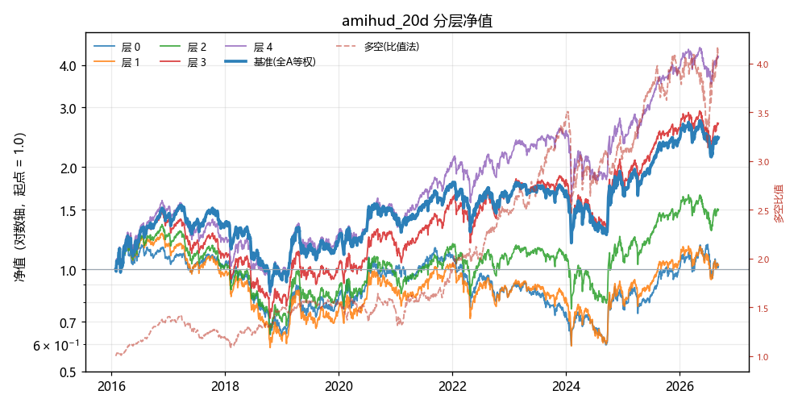

# Mini-Alpha

> 这是什么：**一个学生搭建的「能自己加因子、结论可复现」的轻量级 A 股单因子研究平台。**
> *A reproducible single-factor research platform for China A-shares — add a factor in one line.*

---

## 0. 这是什么 / 不是什么（30 秒读完）

| 是  | 不是 |
| :-- | :-- |
| 一个可以跑通：**清洗 → 宽表 → 指标 → 因子 → 分层回测 → 报告** 的研究流程的项目| 实盘交易系统 （没有下单/执行算法/风控） |
| **加一个因子 = 加一条字典**（多数情况） | 多因子组合/中性化平台 （市值、行业还没进来） |
| 每条结论都**可复现**（同输入逐位相同、有台账、有断言） | 行情终端 / 数据销售  |

**能力边界（说清楚）**：
- 现在能**严谨**回答：**「这个因子有没有区分度」** （分层单调性、IC/ICIR、换手、多空、成本后净值）
- 现在还**不能**严谨回答：**「这因子值多少钱」**  —— 涨跌停不可成交、容量、融券、样本外都还欠着（见 [TECH_DEBT.md](TECH_DEBT.md)）
重要的事情说三遍：

没有基本面数据！
没有基本面数据！
没有基本面数据！

不愿意动手的不要用，这不是傻瓜式软件！
不愿意动手的不要用，这不是傻瓜式软件！
不愿意动手的不要用，这不是傻瓜式软件！

---


## 1. 服务于谁

**① 我自己 —— 做 A 股单因子研究。** 改一行 → 5 秒出一份完整报告（分层/IC/多空/换手/图），一晚能试几十个变体 

**② 想理解「怎么做对回测」的人。** 这个仓库把**最容易翻车的那些地方**都摆出来了：含 337 只退市股（不犯生存偏差）、T+1 开盘成交（不偷价）、口径声明写在每份报告头部、以及一本记录"什么时候会咬人"的台账 、以及用哈希值进行数据校验

**③ 想快速对因子进行方向筛选的人**：这个仓库提供的数据清洗流程能够对量价因子进行快速回测，一个因子大概5秒左右，用于轻量级的因子思路的验证，支持批量因子的回测。

---


## 2. 30 秒上手

如果这是你第一次下载，请先花点时间下载好所需的数据源和进行数据的清洗，方法如下：

全量下载直至今日：
```powershell
python -m data.fetcher.baostock_stock_fetcher --start 2015-01-01
```
（`--start` 按你的起点改；`--end` 默认给到今天 ✓ 数小时量级，断了重跑同一条即可续 ✓）

增量更新：
```powershell
python -m data.fetcher.baostock_stock_fetcher --update
```
清洗流程
```powershell
python -m data.cleaner.pipeline all      # 一条命令：清洗 → 面板 → 回测
```

跑回测（单个因子组）：
```powershell
python main.py
```

**批跑（推荐，带自动重试）** —— 见 §3「已知失效模式」：
```powershell
cd 'F:\quant 1.0'
for ($i = 1; $i -le 20; $i++) {
    python main.py *> $null
    if ($LASTEXITCODE -ne 0) { python main.py *> $null }   # 换新进程重试一次 ✓
}
```

**产出在哪**
| 文件 | 内容 |
| :-- | :-- |
| `reports/report_<因子名>_close.md` | 每个因子一份报告（分层表 / IC / 多空 / 口径声明） |
| `reports/nav_<因子名>_close.png` | 分层净值曲线（含多空） |
| `logs/run.log` | 每次运行的日志 + 每因子的关键数字 |
| `data/storage/cleaner_meta.json` | 清洗总账（只数 / 行数 / 失败清单 / 源指纹） |

**首次运行会重建面板**（30–90 秒 ✓ 见 §3），之后都是命中缓存（1.3 秒）✓

---


## 3. 性能（自己实测下来的结果）

| 场景 | 耗时 | 说明 |
| :-- | --: | :-- |
| **全库清洗**（5,471 只） | **159–233 s** | 一次读 5,471 个 parquet，写净数据 727 MB |
| **面板重建**（首次 / `panel.py` 改过） | **30–90 s** | 读净数据 → 拼 5 张宽表（2,839 × 5,471） |
| **面板命中** | **~1.3 s** | 绝大多数运行都是这个 |
| **单因子回测**（含报告与图） | **~2.5 s** | 分层 → 权重 → 引擎 → IC → 报告 |
| **6 因子全跑**（命中） | **~16 s** | 就是 `python main.py` 的日常耗时 |

> 2026-10-19：把「**大数组的写入权**」从库手里收回之后（见 [PITFALLS #24](PITFALLS.md)）——
> 单因子 **5 s → 2.5 s**，6 因子 **27 s → 16 s**；而 6 个因子的结论数字**一字未变** ✓✓
>
> **已知失效模式（重要）**：约 **5% 的运行**会因环境级数据退化被内部断言拦下
> （`layer ... turnover < 20`，**不产出任何报告**）。机制是**进程级、一次性**的——
> **换一个新进程重跑即可恢复**（§2 的批跑写法已经自动做了这一步）。


---


## 4. 怎么用 —— 四种情况，请对号入座：
小提示：
> **判断依据**：我要用的指标，在 `panels`（宽表）的 key 里能找到吗？（panels输不输出对应指标的宽表）
> - **找得到** → 走 **4.1**（秒级）
> - **找不到、但净数据里有** → 走 **4.3**（30–90 s）
> **净数据里也没有** → 先补数据源/清洗层（4.3 的上游）

### 4.1 加一个因子（指标已存在）—— 最常见，只用改1处

`backtest/factors.py` 的 `FACTORS` 里加一条：

```python
"rev_10d": {
    "fn": lambda f, p: f["ret_10"],       # 取哪个指标列
    "needs": [("ret", {"n": 10})],        # 要算哪些指标（列表）
    "requires": ["ret_1d_hfq"],           # 要哪些面板表（并集）
    "sign": -1,                           # 定向只乘这一次 
    "note": "10 日反转",
},
```
**验收**：老因子黄金值不变 ✓ · 新因子出数（不是 skipped） · 累计换手 > 20 

### 4.2 组合多个指标成一个因子 —— 仍然只改 `factors.py` 

```python
"illiquidity_vol_20d": {
    "fn": lambda f, p: f["amihud_20"] * f["vol_20"],       # 乘法：不用去量纲 
    "needs": [("amihud", {"n": 20}), ("vol", {"n": 20})],  # 要几个列几个
    "requires": ["amount", "ret_1d_hfq"],
    "sign": -1, "note": "非流动性 × 波动",
},
```


### 4.3 需要「新面板表」（净数据里有、宽表里没有）—— 改 `panel.py` 两处 

```python
# ① 声明（也让缓存文件知道要存这张表）
FIELDS = ["hfq_close", "hfq_open", "ret_1d_hfq", "can_trade", "amount"]
# ② build_panels 里：加一个收集列表 + append + 返回字典里加一项
a_l = []
...
a_l.append(pd.Series(pd.to_numeric(d["amount"], errors="coerce").to_numpy(), index=idx, name=p.stem))
...
"amount": pd.concat(a_l, axis=1).sort_index().astype("float32"),
```
**代价**：`panel.py` 变了 ⇒ 面板缓存**自动失效** ⇒ 重建 **30–90 s**（一次性 ✓）
**这不是缺陷** ✓ —— 代码变了、数据可能变，宁可白建也不用旧缓存 

### 4.4 需要「新指标」（用已有宽表算）—— 改 `features.py` + `factors.py`

```python
# features.py
def amt_trend(panels, n):            # 吃宽表 → 吐宽表（形状必须一致 ）
    a = panels["amount"].ffill()
    ma = a.rolling(n, min_periods=n).mean()
    out = (ma / ma.where(ma > 0).shift(n) - 1.0).astype("float32")   # where 防除零 
    _bad = int(out.iloc[:2*n].notna().to_numpy().sum())              # 预热不变量 
    assert _bad == 0, f"amt_trend({n}) 预热 2n 行出现 {_bad} 个非 NaN"
    return out

FEATURES = {..., "amt_trend": amt_trend}     # 挂进注册表
```
三条硬要求：① 输出 index/columns 与 panels 一致（**绝不 dropna/reindex**）② 首段全 NaN + 断言 ③ `.astype("float32")`


## 5. 目录与数据流（方便你快速理解代码的架构）：

```
data/storage/stock_daily/        原始 parquet（5,471 只，含退市）
      │  data/cleaner/*  5 个环节：align → suspension → price → adjust → derived
      ▼
data/storage/cleaner_daily/      净数据（20 列 / 727 MB）——「原料」
      │  backtest/panel.py       把列搬成宽表（FIELDS）
      ▼
宽表 5 张（2,839 交易日 × 5,471 只）—— hfq_close / hfq_open / ret_1d_hfq / can_trade / amount
      │  backtest/features.py    在宽表上算「指标」（vol / ma_dev / amihud …）
      ▼
指标表 → backtest/factors.py 声明（needs / requires / fn / sign）→ 因子值
      │  backtest/weights.py     名次分层 → 5 层等权权重（★只吃因子值，不碰宽表）
      ▼
backtest/engine.py（T+1 开盘成交 / 成本 / 8 本账）→ metrics.py → report.py → reports/
```

**流程梳理**：**清洗出料 → 面板铺平 → 特征算指标 → 因子定方向 → 权重分层 → 引擎算账 → 报告** 

| 层 | 只做一件事 | 什么时候需要你动 |
| :-- | :-- | :-- |
| `data/cleaner/` | 逐只（长表）清洗，产出**原料与半成品** | 数据源加列 / 加清洗环节 |
| `backtest/panel.py` | **把列搬成宽表** | 宽表里缺你要的列（30–90 s） |
| `backtest/features.py` | 在宽表上算**指标** | 要新指标（秒级） |
| `backtest/factors.py` | **声明因子**（要什么、怎么组合、正负号） | 加/改因子（秒级） |
| `backtest/weights.py` | 因子值 → 分层权重 | 想换分层/加权方式时 |
| `backtest/engine.py` / `metrics.py` / `report.py` | 撮合 / 指标 / 排版 | 换**口径**时才动 |

---


## 6. 结果长什么样 —— 以 `amihud_20d`（今天新加的非流动性因子）为例

**一次完整的「加因子」全流程（今天真跑过 ✓）**

| 步 | 做了什么 | 耗时 |
| :-: | :-- | --: |
| ① | 发现它被 `skipped ⚠ 面板缺 ['amount']`（`requires` 声明在干活 ✓） | — |
| ② | `panel.py` 加一张 `amount` 宽表（`FIELDS` + `build_panels`） | 重建 30–90 s |
| ③ | `features.py` **一行没改**（`amihud` 早就写好了 ✓） | 0 |
| ④ | `factors.py` **一行没改**（因子早已声明 ✓） | 0 |
| ⑤ | `python main.py` | ~30 s |

**它跑出来的报告（真实片段）**

```
# 因子回测报告 · amihud_20d
> 口径声明：区间 2015-01-05 ~ 2026-09-07 ｜ 调仓月频（129 期）｜ 净值 close ｜ 成交 T+1 开盘
> 年化常数 244（A 股）｜ 佣金 0.00025/0.00075 ｜ 滑点 0.0005 ｜ 多空以比值法为准
```

| 层 | 期末净值 | 年化 | 波动 | 最大回撤 | 夏普 | 累计换手 |
| :-: | --: | --: | --: | --: | --: | --: |
| 0 | 0.9836 | −0.14% | 21.70% | −51.91% | −0.0066 | 27.16 |
| 1 | 1.0077 | 0.07% | 22.98% | −56.37% | 0.0029 | 56.12 |
| 2 | 1.4926 | 3.50% | 23.30% | −54.32% | 0.1503 | 66.73 |
| 3 | 2.6748 | 8.82% | 23.30% | −53.32% | 0.3787 | 64.08 |
| **4** | **4.4470** | **13.68%** | 23.30% | −49.26% | **0.5872** | 37.17 |

**IC 均值 0.0597 ｜ IC-IR 1.3789 ｜ 期数 128 ｜ 多空（比值法）352.12%**



> 5 层净值（起点 1.0，5 条实线）+ 多空（层4/层0，红虚线）

> **单调 ✓**：0.98 → 1.01 → 1.49 → 2.67 → 4.45
> **而且 5 个老因子的层0换手一字未变**（100.1725 / 96.5218 / 51.7934 / 72.5201 / 99.5793）
> ⇒ **加一张表、多一个因子，没有动到任何已有的结论** ✓


## 7. FAQ（每条都踩坑过）

**Q1：我加了因子，为什么报告里没有它？**
`requires` 漏写了  —— 缺面板表时因子会被**静默跳过**（只 `print` 一行，不进日志 ）。先看终端有没有 `跳过 xxx：面板里没有 yyy` 

**Q2：为什么这次跑了几十秒，平时只要 27 秒？**
你改了 `panel.py`（或净数据变了）⇒ 面板缓存**自动失效** ⇒ 重建 30–90 s （一次性 ）。判据见 `panel.py` 的四个条件。

**Q3：为什么数字和上次不一样？**
先分清是"**口径变了**"（区间/复权/成本/成交假设 ，报告头部会写 ）还是"**数据变了**"（跑过清洗 `cleaner_meta.json` 的 `built_at` 会变 ）。两者都不是 ⇒ 那就是 bug，去看 `logs/run.log` 

**Q4：加一张面板表要动几处？**
两处：`FIELDS`（声明 + 缓存命名）+ `build_panels`（真正的取数）。**只改一处会直接报错**（找不到缓存文件） —— 它会响亮地炸，不会静默 


## 8. 局限与路线图

| 阶段 | 内容 | 状态 |
| :-: | :-- | :-- |
| 完成 | 单因子研究闭环（清洗 → 宽表 → 指标 → 因子 → 分层 → 报告）· 一条命令跑全链 · 可复现与台账 | 今天 |
| 下一步 | 扩数据源（**市值/股本 + 行业**）→ 因子**中性化** → 多因子合成与相关性去重 | — |
| 之后 | 组合层（等权/风险平价/最小方差）· 执行层（涨跌停/容量/融券）· 回测提速（面板常驻 + 引擎按调仓日切片） | — |
| 远期 | 表达式因子（输入 `rank(ret(5))` 直接出报告）→ 交互式研究界面 | — |

**这个项目不追求"一次写出万能框架"** —— 它追求的是：**加东西只加登记，改口径有据可查** 

---


## 一些踩过的坑：           

| # | 坑 | 说明 |
| :-: | :-- | :-- |
| 3 | 复权算法差异 | "后复权" ≠ "官方因子法"：厂商序列出现 `hfq/raw < 1`，直接弃用该源 |
| 7 | 架构文档漏掉数据读取层 | 只写了中间的处理环节，"df 从哪来"没人定义 → 契约的第一格隐形 |
| 9 | 契约字段只写在文档里 | 架构文档说报告有 `columns_added`，代码模板却没预置 —— dict 拼错键名还不报错 |
| 11 | 新列含未来信息 | 停牌「段总长」在段第 1 天就已知 —— 聚合量当特征落列 = 提前看未来 |
| 12 | **只规划了标记，没规划异常冲击** | 停牌环节从头到尾没出现「复牌」二字 —— 复牌日 +488% 能把 20 日波动率从 1.7% 打到 109% |
| 13 | **未请求的重构** | 我让 AI 改「派生掩码」的命名，它顺手把「原始字段」的短名也改长了 —— 逻辑没变，代码反而更冗杂 |
| 15 | 装配层重算已有列 | panel 又乘了一遍 `close × factor`，而 `cleaner_daily` 里已有 `adjust` 的 `hfq_close` → 复权口径出现第二个家 |
| 16 | **拼宽表把缺失格判成「可交易」** | bool 列进 `concat` 升成 object，`astype(bool)` 把 NaN 变 True → 未上市/退市的日子被当成可交易（每天虚增约 1,400 只） |
| 18 | **相关性表把"缺因子的那天"平均进去** | pandas 按并集对齐 → 那一行/列整行变 NaN，除法后是"它跟谁都不相关"的假结论，全程不报错 |
| 19 | **外壳函数的默认参数藏着口径** | 不传 `rdates` → **141** 行、传 2016 起 → **129** 行：两条路都不报错，13/13 验收也打不到（测试只打核心函数） |
| 20 | **"看"和"做"用了两个时点** | 账户估值用**收盘**、成交用**开盘** → 同一天的收益被劈成两半（隔夜属旧组合、日内属新组合）；而 `nav_pre` 用完即弃，连"成交前 − 成交后 = 费用"都验不了。实测口径差：年化 ≤ 0.19pp（结论不变），但波动 +1.4pp、多空比值法 268.10% → 277.05% |
| 21 | **年化常数照抄 252（美股日历）** | A 股一年只有 **242–244** 个交易日 → 年化**系统性高估**：层 2 实测 252 → **8.09%** vs 244 → **7.81%**（约 0.3pp/年）。差异只落在指数上，净值和排序都不变、验收也不会红 —— **常数不是装饰，它编码了"我的市场"** |
| 23 | **非确定性缺陷（同一输入两次跑出不同结果）** | `python main.py` 连跑约 **1/3** 概率里某因子某层数字不同。最诡异的证据：**源表健康、拷贝出来的对象却全零、当场重算又正常** —— "对象的身份与内容脱钩"，既不是逻辑错也不是口径错。**不报错、跑一次测试全绿** → 对策只能是**留证据**（确定性断言 + 哨兵 + 入口健康度断言），不是更仔细地读代码 |

完整 23 条（含症状、根因、实验证据、教训）→ [PITFALLS.md](PITFALLS.md)

**已知但故意没修的假设**（研究阶段不影响结论、可执行性阶段必修，计入 [TECH_DEBT.md](TECH_DEBT.md)）


## 我和 AI 怎么协作

- AI 负责**教学文档、规格、Review**；然后我自己再网上去查询官方文档和资料再学习一遍，紧接着写业务代码（`data/loader.py`、`data/cleaner/*`）；
- AI 的每个结论我都实测验证——包括边界情况，"先让它红一次"再接受；
- **每条结论我都要追问一句"这是实测还是推断"**：实测的要给数字和命令，推断的降级成备注，
  不确定的当场做个小实验。
  阅读代码遇到了ai写错的部分就开始反问ai来暴露问题并思考解决方案
  只有追问能让问题暴露；而它答得起，因为基于问题衍生的方案对它是低成本的，且可验证。
- 我抓到的 AI 错误也照记不误，可以去看看ai写的代码会犯多少奇怪和致命的错误
- 真心话：抗拒ai进入编程的环节是不合理的，这几个月感觉下来人在编程中承担的角色已经发生了极大改变
  但是重要的事情说三遍：
  ai不是许愿机！
  ai不是许愿机！
  ai不是许愿机！

---


## 数据说明与免责声明

> **代码许可：[MIT](LICENSE)**（可自由使用/修改/商用，保留版权声明即可）
> ⚠️ **数据不在许可范围内**：行情数据来自 baostock，受其自身使用条款约束（禁止并发连接 / 每日请求上限）；数据文件不入库 ✓

- 数据源 **baostock**（官方复权因子）；数据文件**不入库**（见 `.gitignore`），仓库只放代码与文档；
- 本地复现：`python data/fetcher/baostock_stock_fetcher.py --end <最近已收盘交易日>`
  （官方限制：**禁止并发连接**、每日请求 ≤ 5 万次）；
- 个人学习项目，**非投资建议**；不保证数据完整性与策略有效性。

---


## 附录

- **[开发日志](开发日志.md)** —— 两次「认知重构」+ 20 条逐日记录（原文一字未改）
- **[PITFALLS.md](PITFALLS.md)** —— 23 条踩坑记录（含 5 条被证伪的假设）
- **[TECH_DEBT.md](TECH_DEBT.md)** —— 15 条技术债，每条写"什么时候咬人"
- **`教学文档/`** —— 每一格的教学参考（本地私有，不入公开仓）
